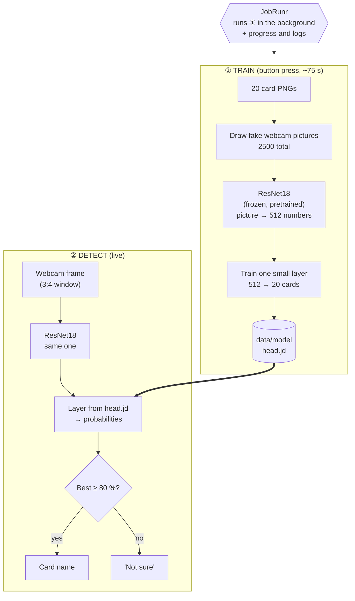

# How it works

**Idea:** show a card to the webcam, get its name. No photos taken by hand.

## The whole flow



## ① Train

| What | Detail |
|---|---|
| **Trigger** | Button **Train the model** or `POST /api/jobs/train` |
| **Never** | Not at startup, not on a schedule |
| **Data** | Drawn from `cards/png`, nothing downloaded |
| **Per card** | 100 to train, 25 to check |
| **Check set** | Pictures the model never trained on |
| **Time** | ~75 s drawing + ResNet, ~1 s training |
| **Output** | `data/model/` |

**Fake pictures contain:** perspective, thumb over the card, glare, blur, noise, JPEG artefacts, random room.

**Why so fast?** Only the small last layer learns. ResNet18 never changes.

## JobRunr's job

- Takes the training **off the web request**
- Request returns at once (`202 Accepted`)
- Job stored in H2 (`data/jobrunr-db`)
- **Dashboard** shows progress bar, logs, errors: http://localhost:8000/dashboard
- Retries: **none**

## ② Detect

1. Browser crops the card window, sends JPEG to `/api/predict`
2. ResNet18 → 512 numbers
3. Layer → 20 probabilities
4. Best below 80 %? → **"Not sure"**
5. New model saved? → reloaded automatically

No model yet → `409`.

## Where to look in the code

| Step | Class |
|---|---|
| Start job | `TrainingController` |
| The job | `CardTrainingJob` |
| Draw pictures | `CardImageSynthesizer` |
| ResNet18 | `Backbone` |
| Fit the layer | `HeadTrainer` |
| Classify | `CardClassifier`, `CardPredictionService` |

## Run

```bash
./mvnw spring-boot:run
```

JDK 25. First training downloads PyTorch + ResNet18 once.
