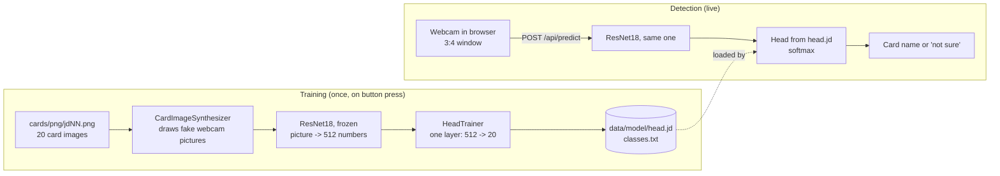

# How the classifier works

One page for the live coding session: who does what, where the training data comes from, when training happens, and how a card on the webcam becomes a name.

## The big picture



Nothing is photographed by hand. The training data is drawn from the 20 card PNGs.

## 1. What JobRunr does here

JobRunr runs the training as a **background job**, so the web request returns at once and the work does not block the server.

1. The start page calls `POST /api/jobs/train` ([TrainingController](../src/main/java/org/jobrunr/democatch/web/TrainingController.java)).
2. The controller does `jobScheduler.enqueue(() -> trainingJob.train(JobContext.Null))` and answers `202 Accepted`. The job is stored in the H2 database (`data/jobrunr-db`).
3. A JobRunr background server thread, inside the same Spring Boot app, picks the job up and calls [CardTrainingJob.train](../src/main/java/org/jobrunr/democatch/jobs/CardTrainingJob.java).
4. While it runs, `jobContext.progressBar(...)` and the `JobRunrDashboardLogger` feed the **dashboard** at http://localhost:8000/dashboard: progress bar, log lines per card, per-5-epoch accuracy.
5. Because the job is persisted, a failure shows up in the dashboard with its stack trace. `retries = 0`, so a failed training is not repeated by itself.

`TrainingStatus` is an in-memory twin of the job state that the start page polls every second through `GET /api/jobs/status`. It also makes sure only one training runs at a time.

## 2. Where the training data comes from

[CardImageSynthesizer](../src/main/java/org/jobrunr/democatch/synth/CardImageSynthesizer.java) takes the card PNG and draws a "webcam picture" of it:

- the card in **perspective** (a homography, see `Homography`), at random angle and distance
- partly covered by a **thumb** (random skin tones)
- **glare**, blur, noise, **JPEG artefacts**, odd lighting
- a **random room** behind it

The pictures are 240 x 320 px, the same 3:4 layout as the card window on the capture page.

| Set | Per card | Used for |
|---|---|---|
| Training | 100 (`app.synthetic.per-card`) | fitting the layer |
| Validation | 25 (`app.synthetic.valid-per-card`) | accuracy check, drawn with other random seeds, never trained on |

20 cards give 2000 training and 500 validation pictures. The seed is fixed (`app.synthetic.seed=42`), so every run draws the same pictures.

Look at some of them: `./mvnw compile exec:java@preview` writes 5 per card to `data/preview/` (`-DperCard=10` for more).

Optional: real photos from `/capture.html` land in `data/captures/<card>/` and are added to the training data with `app.train.use-captures=true`. Off by default.

## 3. When it trains

Only when you press **Train the model** (or `POST /api/jobs/train`). Not at startup, not on a schedule. About 75 s on a 16 core CPU:

| Step | What happens | Time |
|---|---|---|
| Draw + embed | per card: draw 125 pictures (parallel), run them through ResNet18 in batches of 32 | ~75 s |
| Train | `HeadTrainer`, 60 epochs on the 512-number vectors | ~1 s |
| Check + save | accuracy on the 500 unseen pictures, write `data/model/` | instant |

Training is fast because only **one small layer** is learned. ResNet18 is never changed. Most of the time goes to showing the pictures to ResNet18 once. After that the training works on plain numbers.

Written to `data/model/`: `head.jd` (the layer's weights), `classes.txt` (card ids, written last), `model.properties` (accuracy, timings), `evaluation.json` (per card accuracy and confusion matrix, shown on `/evaluation.html`).

## 4. How classification works

Same ResNet18, same layer, now on one picture at a time:

1. The browser grabs the video frame, crops the **centre 3:4 window** (the card outline on the page) and sends it as JPEG to `POST /api/predict` ([PredictionController](../src/main/java/org/jobrunr/democatch/web/PredictionController.java)).
2. [Backbone](../src/main/java/org/jobrunr/democatch/ml/Backbone.java): scales it to 224 x 224, normalizes it, runs ResNet18 without its last layer. Result: **512 numbers** that describe what is in the picture. Training used exactly the same preparation.
3. [CardClassifier](../src/main/java/org/jobrunr/democatch/ml/CardClassifier.java): `logits = weight x features + bias` gives 20 scores, `softmax` turns them into probabilities that add up to 1.
4. [CardPredictionService](../src/main/java/org/jobrunr/democatch/web/CardPredictionService.java) returns the best card plus the top 3. If the best probability is below `app.unsure-below` (0.8) it says **"not sure"** instead of naming a card.
5. The service watches `classes.txt`: when a new training finishes it reloads the layer, no restart needed.

Before the first training there is no model: `/api/predict` answers `409`.

## Why it is built this way

- **Transfer learning**: ResNet18 already knows edges, shapes and textures from ImageNet. We only teach it which of 20 cards is which.
- **Synthetic data**: no photo session, and the app can be retrained at any time. The open question is how well drawn pictures match a real webcam (about 87 % on drawn pictures, with "not sure" below 80 % confidence).
- **JobRunr**: long work out of the request thread, with progress, logs and failures visible without writing any UI for it.

## Run it

```bash
./mvnw spring-boot:run
```

Needs JDK 25. The first training downloads PyTorch (native libraries) and the ResNet18 weights once, and caches them in `~/.djl.ai`. The card pictures themselves are not downloaded, they are drawn locally.
